# Plugin SDK

A sideloaded plugin is a **process**. DragonFruit starts it, speaks a small
versioned protocol over stdio, and hands bulk layer data through a shared byte
ring. `rust/dragonfruit-plugin-sdk` gives you that protocol so your binary is a
`main` and one trait impl.

The reason the boundary is a process and an SDK rather than a `dlopen`: see
`docs/adr/0047-sideloaded-complex-plugins.md`. The package format, the trust
model and the host side are in `docs/dev/plugins-sideloaded.md`.

Throughout this section the example is **AlphaBeta**'s `AlphaPrint` plugin —
`alphabeta.alphaprint`, format `.apf`, capabilities `slicerEncoder`,
`networkOperations` and `fileType`.

## Status

Read this before trusting a page in this section. The protocol is being built in
slices, and each capability is either shipped or designed.

| Capability | Wire contract | SDK support | Host support |
| --- | --- | --- | --- |
| handshake (`hello` / `ready` / `shutdown` / `error`) | shipped | shipped | shipped: spawn, `ready` validation against the manifest, idle stop |
| `networkOperations` (`network` / `networkResult`) | shipped | shipped | shipped: routed after the built-in dispatch match |
| `slicerEncoder` (`encodeBegin` / `encodeLayer` / `encodeDone`) | shipped | shipped | shipped: one process per session, ring mapping in `DF_PLUGIN_RING`, adapter registered into the engine's encoder registry |
| ring accessors (slot publish / view / release) | shipped | shipped | shipped, for encoders |
| `fileType` (`import.detect` / `import`) | designed | designed | designed, and blocked on the scene document schema (see the page) |

Pages mark their own status. A "designed" page is the contract to build against;
it is not a description of running code.

## Mental model

```mermaid
flowchart LR
  subgraph DF[DragonFruit]
    H[host: import, verify,<br/>spawn, ring]
  end
  subgraph P[your binary]
    S[serve&#40;stdin, stdout, identity&#41;]
    C[your capability code]
  end
  H -- hello / shutdown / jobs --> S
  S -- ready / progress / errors --> H
  H <-- "shared ring: opaque byte slots" --> C
  S --> C
```

Three rules decide almost every design question in this section:

1. **Bytes cross the ring, JSON crosses the pipe.** Control messages are small
   and readable; layer payloads are not parsed by the other side at all.
2. **The manifest is the policy, the handshake is the claim.** The host shows
   the manifest's capabilities at import; at start it checks the plugin's
   `ready` against them and refuses a plugin that advertises more.
3. **The SDK has no DragonFruit code in it.** No engine types, no scene types,
   no host traits. That is what keeps your binary yours under licence, and it is
   also why the SDK cannot hand you a printer profile parser, an HTTP client or
   a database — bring your own crates.

## Lifecycle

| Step | Who | What happens |
| --- | --- | --- |
| import | host | signature, seal, `minAppVersion`, publisher fingerprint pin, payload extracted under the app data dir |
| enable | user | sideloading is off by default; the package-level import is gated behind an explicit acknowledgement |
| start | host | spawns `payload/bin/<platform>/<binary>`, sends `hello` with `proto` and `transport`, waits for `ready` |
| check | host | `ready.pluginId` must equal the manifest id; capabilities and formats must be a subset of the manifest's |
| work | both | one request per operation; progress and cancellation flow back over the pipe |
| stop | host | `shutdown`, then the process is expected to exit; an idle process is killed and respawned on demand |

The host keeps **one process per plugin**, warm between operations: state your
plugin builds up (HTTP pools, discovered printers, upload bookkeeping) survives
between calls, exactly as it would in a long-lived daemon.

## What a plugin cannot do

- **Ship UI.** There is no remote JS in this tier by design. A plugin cannot
  contribute settings panels, monitoring dashboards or custom editors; those are
  in-process TS contracts of the compiled-in tier. The host surface for a
  sideloaded plugin is the generic one: formats it can encode, operations it
  answers, file types it can import.
- **Touch the scene, the slicer or the filesystem layout.** It gets a job
  description, layer bytes and an output path. Nothing else is handed over.
- **Use DragonFruit's crates.** `zip`, the shared HTTP client, the mdns
  discovery helpers: bring your own. A plugin binary is a few MB larger for it.
- **Assume privileges it did not declare.** A package that declares
  `slicerEncoder` and answers a `network` request is refused.

## Content beyond code

Printer profiles and material templates are **data**, and today they reach
DragonFruit only through the simple-plugin tier (a GitHub manifest with
`printerPresets` / `materialTemplates`). A `.dfplugin` payload has `bin/`,
`lib/`, `assets/` and a manifest, and no preset section — so a sideloaded
package cannot yet register printer profiles of its own. If AlphaBeta needs
them, the manifest needs a `presets` reference to a payload JSON that the host
validates with the same rules as the simple tier; that is a spec change with a
loader behind it, not something to work around.

## Pages

- `docs/dev/plugins-sdk/authoring.md` — build, seal, pack, import a working plugin
- `docs/dev/plugins-sdk/protocol.md` — frames, messages, the ring, versioning
- `docs/dev/plugins-sdk/encoders.md` — the `slicerEncoder` contract (designed)
- `docs/dev/plugins-sdk/network.md` — the `networkOperations` contract (designed)
- `docs/dev/plugins-sdk/file-types.md` — the `fileType` contract (designed)
- `docs/dev/plugins-sideloaded.md` — host side: package format and verification
