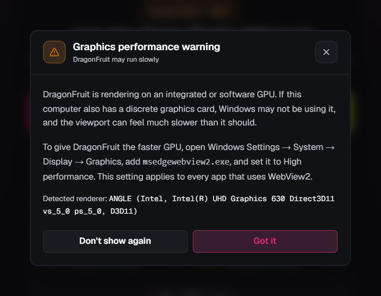

# Troubleshooting

If DragonFruit shows you an error or warning, find the page for what you were doing and search it for the words on your screen. Each entry starts with the fix; **More detail** says when the message appears and why.

| If you were… | See |
| --- | --- |
| Importing a model or scene, opening or saving a `.voxl` scene, or recovering an autosave | [Opening and saving](opening-and-saving.md) |
| Repairing a mesh, hollowing, or punching drain holes | [Mesh repair and hollowing](repair-and-hollowing.md) |
| Slicing, exporting, connecting to a printer, sending a print, or using the printer monitor and webcam | [Slicing, export and printers](slicing-and-printers.md) |
| Placing supports, running auto supports, updating DragonFruit, or using backups | [Supports, updates and backups](supports-updates-backups.md) |
| Seeing a warning that DragonFruit is using the integrated GPU | [Integrated GPU warning](#integrated-gpu-warning) |

> [!NOTE]
> **Messages change between versions.** These pages describe the current development version. If a message on your screen reads differently, check **Settings** > **Updates** for a newer version (on Linux, DragonFruit updates through Flatpak), and search the [issue tracker](https://github.com/Open-Resin-Alliance/DragonFruit/issues) for the words you see.

## Integrated GPU warning

DragonFruit shows this warning when Windows is rendering the interface on an integrated or software GPU. The viewport can feel much slower than it should, especially on a laptop that also has a discrete NVIDIA or AMD card.

**Fix: tell Windows to use the faster GPU for WebView2.**

1. Open **Settings** → **System** → **Display** → **Graphics**.
2. Under **Add an app**, choose **Desktop app**, then browse to `msedgewebview2.exe`. The easiest way to find it is Task Manager: open the **Details** tab, right-click `msedgewebview2.exe`, and choose **Open file location**.
3. Select `msedgewebview2.exe`, choose **Options**, set it to **High performance**, and save.
4. Restart DragonFruit.

The setting applies to every app that uses WebView2, not only DragonFruit. If the warning appears on a computer with no discrete GPU, there is nothing to switch to; choose **Don't show again**.

**More detail:** the warning is only shown on Windows. DragonFruit already asks WebView2 for the high-performance GPU; the warning appears when the WebView2 runtime is older than version 145 or the driver still selects the integrated adapter. Updating the WebView2 runtime from Microsoft's website can also fix it.

## Reporting a problem

When a fix says to report the problem, or nothing here matches, open a new issue at https://github.com/Open-Resin-Alliance/DragonFruit/issues/new. Search existing issues first; adding your details to a matching issue helps more than opening a duplicate.

Include:

1. **The exact message**, including any text after a colon. A screenshot works.
2. **What you did just before it appeared**, step by step.
3. **Your DragonFruit version** (shown in **Settings** > **About**), your operating system and, for printing problems, your printer model and file format.
4. **The log file.** Open **Settings** > **Logging**. The path is under **Log File**; the buttons next to it copy the path or reveal the file in your file manager.
5. **For mesh repair problems**, the report from **Copy JSON** in the repair report.

> [!NOTE]
> **Many errors are not in the log file.** The log file mostly records the app's native side. Errors raised in the interface usually are not written to it, so the exact on-screen message and your steps are often the most useful part of a report.

If the problem blocks printing, also include your printer profile, material profile and export format.

## Getting help

- Project issues: https://github.com/Open-Resin-Alliance/DragonFruit/issues
- Community Discord: https://discord.gg/beFeTaPH6v
