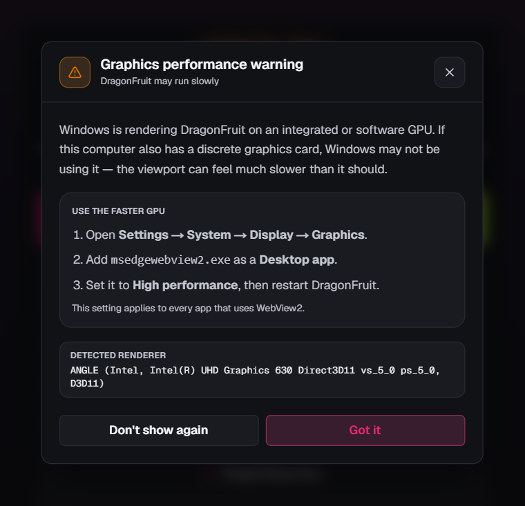

# Troubleshooting

DragonFruit is evolving quickly, so the best source of current troubleshooting information is the GitHub issue tracker.

## Integrated GPU warning

DragonFruit shows this warning when Windows is rendering the interface on an integrated or software GPU. The viewport can feel much slower than it should, especially on a laptop that also has a discrete NVIDIA or AMD card.

**Fix: tell Windows to use the faster GPU for WebView2.**

1. Open **Settings** → **System** → **Display** → **Graphics**.
2. Under **Add an app**, choose **Desktop app**, then browse to `msedgewebview2.exe`. The easiest way to find it is Task Manager: open the **Details** tab, right-click `msedgewebview2.exe`, and choose **Open file location**.
3. Select `msedgewebview2.exe`, choose **Options**, set it to **High performance**, and save.
4. Restart DragonFruit.

The setting applies to every app that uses WebView2, not only DragonFruit. If the warning appears on a computer with no discrete GPU, there is nothing to switch to; choose **Don't show again**.

**More detail:** the warning is only shown on Windows. DragonFruit already asks WebView2 for the high-performance GPU; the warning appears when the WebView2 runtime is older than version 145 or the driver still selects the integrated adapter. Updating the WebView2 runtime from Microsoft's website can also fix it.

## Check existing issues

- Project issues: https://github.com/Open-Resin-Alliance/DragonFruit/issues
- Search before filing to avoid duplicates.

## Report a new issue

When opening an issue, include:

- DragonFruit version/commit (if known)
- OS and hardware details
- Exact reproduction steps
- Expected vs actual behavior
- Screenshots/video if relevant
- Logs or error messages

## Quick links

- New issue: https://github.com/Open-Resin-Alliance/DragonFruit/issues/new
- Repository: https://github.com/Open-Resin-Alliance/DragonFruit

!!! note
      If the issue blocks printing, include printer profile, resin profile, and export format in your report.
