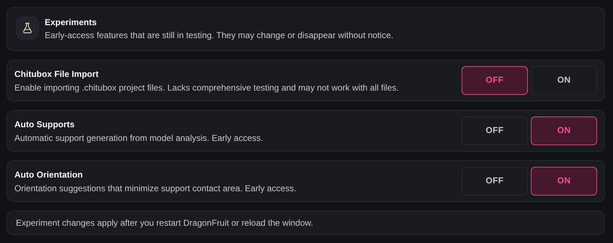
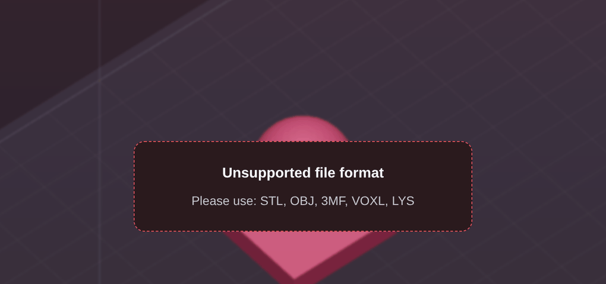
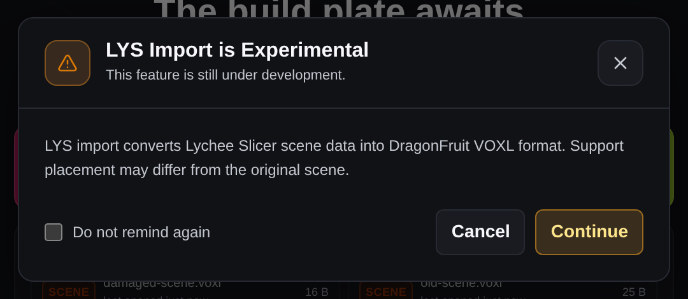
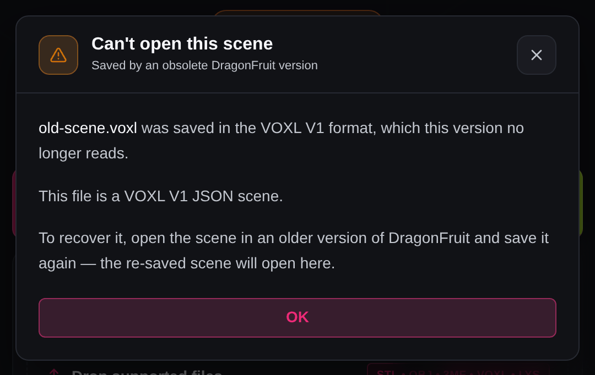

# Troubleshooting: Opening and saving

Problems getting models and scenes in and out of DragonFruit: importing STL, OBJ and 3MF files, Lychee and ChiTuBox scenes, opening and saving `.voxl` scenes, and autosave. Find the message you're seeing; the fix comes first, and **More detail** has the rest.

!!! note "ChiTuBox files need an experiment turned on"
    DragonFruit only opens `.chitubox` and `.ctp` files after you turn on **Chitubox File Import** in **Settings** > **Experiments**, click **Apply**, then **Reload Now**. Save your scene first: reloading discards unsaved changes.

Where to find it

## Opening files

### "Unsupported file format"

<!-- source: src/app/page.tsx -->

DragonFruit doesn't recognise the file's extension. Re-export the model as STL, OBJ or 3MF. For a `.zip`, don't drag it in: open it with **Import mesh…** instead.

More detail

You'll see this while dragging a file over the editor in **Prepare** mode. The start screen says the same thing as "Unsupported file type" or "Unsupported format detected."

DragonFruit only checks the extension. It accepts STL, OBJ and 3MF models, and VOXL and LYS scenes (plus CHITUBOX and CTP if the experiment above is on). Files like `.step` or `.blend` need exporting again from the program that made them.

A `.zip` can't be dropped, but **Import mesh…** or **Import scene…** in the app menu, or **Load Mesh** on the start screen, will open it and list the models and scenes inside.

### Nothing happens after importing a model

<!-- source: src/features/scene/useSceneCollectionManager.ts -->

The file didn't load, and DragonFruit doesn't say why. Check the file opens in another program, then export it again as a binary STL and import that.

More detail

The loading overlay closes and no model appears. Typical causes are an empty file, a 3MF with no mesh inside, or a file the loader can't read. A `.zip` that can't be read, or has nothing usable inside, is skipped the same way. (If you cancelled at the mesh repair prompt, nothing is added; that's expected.)

The reason isn't shown on screen or written to the log file. If the file opens elsewhere but not in DragonFruit, [report it](common-issues.md#reporting-a-problem) with the file name and type, your steps, and the model if you can share it.

### "Could not reopen this file from cache."

<!-- source: src/components/layout/EmptySceneState.tsx -->

The recent file has moved, or DragonFruit's stored copy is gone. Open it again from where it is now with **Load Mesh** or **Import Scene**; that also fixes the recent entry.

More detail

This appears when you click an entry under **Recent files** on the start screen. Either the OBJ or 3MF was moved, renamed, deleted or is on a disconnected drive, or the copy DragonFruit keeps in its own storage is missing (common for older entries, or after the app's storage is cleared).

**Clear** next to **Recent files** empties the whole list, not just the broken entry.

Other quirks of the recent list:

- A moved STL gives no message at all; the click just loads nothing.
- A recent scene reopens from the copy stored when you last opened it, not from the file on disk. If you've changed or moved it since, use **Open scene…**.
- DragonFruit keeps 10 recent files but shows 8.

## Lychee and ChiTuBox scenes

### "… is Experimental"

<!-- source: src/components/organisms/modals/SceneFileModals.tsx -->

Just a warning. Click **Continue**, then check the supports before you slice; they may not match the original scene exactly.

More detail

The title reads "LYS Import is Experimental", "Chitubox Import is Experimental", "Chitubox Pro Import is Experimental" or "Plugin Import is Experimental", with "This feature is still under development." underneath.

These formats are converted into DragonFruit's own, so support placement can differ. For `.chitubox` files the plate position and orientation aren't recovered. Tick **Do not remind again** to stop seeing the warning for that format.

### "Scene import failed: …"

<!-- source: src/features/scene/sceneImportMessages.ts -->

The file is damaged, incomplete, or not the kind of file its extension says. Copy or download it again and retry. If it still fails, open it in the slicer that made it and save it again there.

More detail

This covers `.lys`, `.chitubox` and `.ctp` files. A pop-up with the same reason appears too. The text after the colon tells you which case you're in:

| Message contains | What it means |
| --- | --- |
| "LYS manifest JSON header not found", "Unsupported .lys container variant" | Not a `.lys` layout the importer knows, or not a Lychee scene at all |
| "scene.bin is truncated", "Geometry file too short" | The file was cut off, often by an unfinished download or copy |
| "No geometry .bin file found", "No parseable geometry .bin payloads found", "no object to convert" | The scene has no model the importer could read |
| "Failed to decode scene data", "Failed to parse LYS manifest" | The scene data inside couldn't be read |
| "Not a .chitubox file", "Not a .ctp file", "Invalid .ctp object table" | The file doesn't start like a ChiTuBox project; damaged, or a renamed file |
| "No readable geometry in .ctp container" | The `.ctp` has no model the importer could read |

As a last resort, export the models as STL from the original slicer and import those; you'll lose the supports. If the file opens fine in its own slicer but not here, [report it](common-issues.md#reporting-a-problem) with the message and the file.

### "Imported … scene files (… failed)."

<!-- source: src/features/scene/sceneImportMessages.ts -->

Some files in a batch failed. Import the failed ones one at a time to see each file's own message, then look that up on this page.

More detail

When every file fails, the message is "Scene import failed for all … files." A batch import doesn't show the reason for each file, which is why importing them one by one helps.

## Opening `.voxl` scenes

### "Can't open this scene"

<!-- source: src/components/modals/ObsoleteVoxlVersionModal.tsx -->

The scene was saved by an early pre-release DragonFruit in the old VOXL V1 format. Open it in an older build that still reads it, save it again, then open the new file here.

More detail

The dialog's subtitle is "Saved by an obsolete DragonFruit version", and a "Could not open …: unsupported VOXL version." toast appears with it. Current versions refuse V1 files rather than load them halfway.

### "VOXL import failed: …"

<!-- source: src/features/scene/sceneImportMessages.ts -->

Either the scene came from a newer DragonFruit (update yours) or the file is damaged (copy it again, and let any cloud sync finish first).

More detail

A "Scene import failed:" pop-up with the same reason appears too.

| Message contains | What it means |
| --- | --- |
| "Unsupported VOXL binary version … Expected 2 or 3" | Saved by a newer DragonFruit than yours |
| "Not a VOXL file: the VOXL binary header is missing" | Not a DragonFruit scene; a renamed or empty file |
| "too small", "truncated directory", "extends beyond file boundary", "size mismatch after decompression" | Cut off or damaged, often by an unfinished copy, download or sync |
| "missing META chunk", "missing SUPP chunk" | Parts of the scene are missing from the file |

To update on Windows and macOS, use **Settings** > **Updates** > **Check for Updates**. On Linux, DragonFruit updates through Flatpak (your software center, or flatpak update).

For a damaged file, also look next to it for a recovery copy named like *name*_autosave.voxl, and try opening that.

### "Imported VOXL scene: … skipped … models."

<!-- source: src/features/scene/sceneImportMessages.ts -->

The scene opened, but some models couldn't be loaded and were left out. Re-import the missing ones from their original STL, OBJ or 3MF files and save the scene.

More detail

If every model is skipped, the message is "VOXL import finished with no importable meshes." instead.

A model is skipped when its mesh data is missing from the file, or fails to load or pass its integrity check. DragonFruit doesn't say which models it skipped, so compare the scene with what you expected. If the file was copied or synced, a fresh copy may fix it.

## Saving scenes

!!! note "Hidden models aren't saved"
    **Save scene** only writes the models that are visible. Show everything before you save if you want to keep hidden models.

### "Could not save the scene"

<!-- source: src/app/page.tsx -->

The file couldn't be written. Use **Save scene as…** to save to a local folder you own, like Documents, and check the drive has space.

More detail

If saving to the current location fails, DragonFruit asks you for a new location first; this message means that second try failed too. Your previous file is safe: scenes are written to a temporary file and only then swapped in.

The message under the title names the file and your system's reason, for example "Failed creating destination directory", "Failed flushing … to disk before commit" or "Failed committing … after 3 attempts". The usual causes:

- a folder you can't write to
- a full disk
- a drive or network share that went away
- antivirus, cloud sync or a file preview holding the file open (pause the sync or wait a moment, then save again)

"Could not write … to the selected destination." means it failed without a more specific reason.

### "Scene is too large to save"

<!-- source: src/app/page.tsx -->

The scene, or one model in it, is over the `.voxl` format's 4 GB limit. Remove one of the largest models listed, or reduce that model's triangle count in your mesh editor.

More detail

The box below the message lists up to five of the largest models with their sizes. The message tells you which case you hit:

- "This scene is … compressed and exceeds the VOXL 4 GB limit." The whole scene is too big. Remove a large model or split the scene into two.
- "“…” is … on its own, which exceeds the VOXL 4 GB limit for a single mesh." One model is too big by itself (compressed or not). Splitting the scene won't help; that model has to get smaller, or come out.

The message also suggests turning off "Save original model along with decimated". This version has no setting with that name, so use the steps above.

## Autosave and crash recovery

### "Restore Failed"

<!-- source: src/app/page.tsx -->

The recovery copy couldn't be loaded, and it's now gone. Open your last saved copy of the scene instead.

More detail

This appears after you click **Restore** in the **Unsaved Scene Found** dialog. The detail says why:

| Detail | What it means |
| --- | --- |
| "The autosave recovery file could not be found." | It was moved or deleted, or sits beside a project folder that isn't reachable |
| "The autosaved recovery file is corrupted or unreadable." | Usually only partly written when DragonFruit closed; a "VOXL import failed" message gives the exact reason |
| "Autosaved VOXL file is empty.", "Failed reading autosaved scene: …" | The reason as stated |

By the time you see this, DragonFruit has already deleted the recovery file, so you can't retry. To protect a recovery copy next time, copy the file in your file manager *before* clicking **Restore**. The dialog shows it under **Name** (hover for the full path), and the subtitle says whether it's beside your project or in DragonFruit's app data folder.

If it keeps happening, [report it](common-issues.md#reporting-a-problem) with the exact message and detail text.

### "Autosave is not working"

<!-- source: src/app/page.tsx -->

Background autosave has failed twice in a row. Save your scene now with **Save scene**, then fix the cause named in the message.

More detail

Without a specific reason the message reads "The background recovery save failed repeatedly." The last line tells you when the last successful autosave was, or says none has succeeded this session. You only see this once per outage.

The causes are the same as for "Could not save the scene" (folder not writable, disk full, drive gone, file locked), or the scene is over the 4 GB limit. The current failure also shows in **Settings** > **Scene Autosave** under **Standing Autosave Error**, and clears by itself once an autosave works; click **Refresh** there to check.

### "Could not write beside the project (…), so the default location is being used."

<!-- source: src/components/settings/SceneAutosaveSettingsTab.tsx -->

Nothing's broken: autosave still works, it just saves to DragonFruit's app data folder instead of next to your project. To change that, save the project with **Save scene as…** somewhere you can write to.

More detail

This shows in **Settings** > **Scene Autosave**, under **Autosave scene file**. The word in brackets is the reason:

| Reason | Meaning |
| --- | --- |
| parent-missing | The project's folder no longer exists or isn't reachable |
| parent-unwritable | DragonFruit can't create files in the project's folder |
| not-a-scene-file | The project isn't a scene file DragonFruit saves to |
| no-project | The scene hasn't been saved as a project yet |

"no-project" can also show when autosave is in fact writing beside your project. Check the path under **Autosave scene file** to see where the copy really is.

## Support data

### "Support import failed."

<!-- source: src/features/scene/sceneImportMessages.ts -->

The file isn't a DragonFruit support export. Pick a support JSON exported from DragonFruit; to bring in a Lychee scene with its supports, use **Import scene…** instead.

More detail

This appears from **Load Support Data (V2)** in the island scan card. "Support import failed." means the file isn't valid JSON (the picker allows `.lys` files here, but this import can't read them). "Support import failed: unsupported support JSON format." means it's JSON but not a DragonFruit support export.

## Messages with no known user fix

These come from unexpected errors, and the code doesn't point to a common cause. Try restarting DragonFruit or repeating the step; if the message comes back, [report it](common-issues.md#reporting-a-problem).

<!-- source: src/features/scene/useSceneCollectionManager.ts -->
<!-- source: src/components/settings/SceneAutosaveSettingsTab.tsx -->

| Message | Where you see it | Also include in your report |
| --- | --- | --- |
| "No registered scene import handler for …", "Unsupported scene file: …" | Opening a scene | What you were opening (check the extension is `.voxl`, `.lys`, `.chitubox` or `.ctp`, and update DragonFruit first) |
| "Failed to load autosave status.", "Failed to mark autosave as clean.", "Failed to open autosave location." | **Settings** > **Scene Autosave** | Which button you clicked |
| "Failed to split supports", "Failed to merge supports", "Scan failed: …" | Right-click a model > **Supports** | The steps you took, and the model if you can share it |

!!! note "Mark Recovery Clean deletes the autosave file"
    **Mark Recovery Clean** in **Settings** > **Scene Autosave** clears the recovery flag *and* deletes the autosave file, so only use it when you're sure you don't need that copy.
