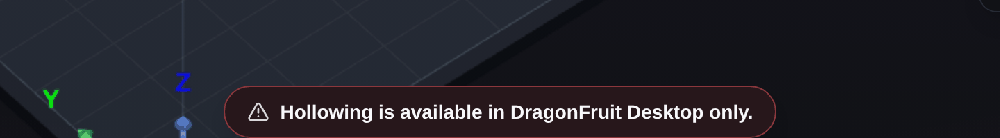

# Troubleshooting: Mesh repair and hollowing

Warnings and errors you can see when DragonFruit checks a mesh on import, repairs it, hollows it, or punches drain holes into it. Find the message you're seeing; the fix comes first, and **More detail** has the rest.

## Mesh checks on import

!!! note "Very large meshes are not checked"
    When automatic repair is on, meshes with 3 million triangles or more skip it on import, so they are not checked or repaired. Run **Auto-Repair** by hand on these.

### "Mesh Issue detected"

<!-- source: src/components/modals/ManifoldWarningModal.tsx -->

Your model isn't a closed solid, which can cause slicing and support problems. Click **Repair Now**, or **Dismiss** and repair it later from the right-click menu.

More detail

The dialog appears right after you import a model, with the subtitle "This mesh isn't a valid solid". The red-striped areas in the viewport mark the parts that failed validation. You see the dialog once per import, even if several models in the batch are flagged.

The mesh has open edges, faces that cross through each other, or surfaces that don't quite meet. Slicing and support placement expect a sealed solid, so these defects can reach the print.

**Repair Now** repairs one model only: the first flagged model in the scene, which may be a model from an earlier import rather than the one you just added. To repair the others, or to repair after clicking **Dismiss**, right-click the model and choose **Repair** > **Auto-Repair**, then click **Repair** in the **Repair Mesh** dialog that opens. If several models are selected, they are all repaired one after another.

If the red stripes are still there afterwards, see "Repair Incomplete" below.

### "Repair recommended before slicing"

<!-- source: src/components/scene/MeshRepairConfirmModal.tsx -->

The file has serious mesh defects, so DragonFruit asks before repairing it. Click **Repair** in most cases, or **Repair parts separately** if the file holds several objects on one plate.

More detail

This appears while a mesh file is importing, before the model is loaded, when **Auto-Repair** is on in **Settings** > **General**. The subtitle reads "This model has severe mesh issues and is likely to need heavy repair." The dialog shows the triangle, component, non-manifold edge and boundary loop counts, plus a disclaimer: "Repair is recommended. Loading this mesh as-is may cause slicing errors or print failures, and successful output cannot be guaranteed."

A quick check found non-manifold edges (edges shared by more than two faces), open holes (boundary loops), faces pointing the wrong way, or 256 or more separate pieces. Repairing a file like this can take a while, which is why you're asked first.

Your choices:

- **Repair** repairs the whole file as one model.
- **Repair parts separately** repairs and reports on each object on its own; the ones that are fine stay as they are. It's only offered when the file has two or more separate shells and was opened from a file on disk (not, for example, from inside a zip archive or dropped into the browser version).
- **Load As-Is** is for when you plan to fix the file elsewhere, or know the defects don't matter.

Closing the dialog cancels the import of this model.

!!! note "Turning automatic repair off"
    Automatic repair on import is set in **Settings** > **General** with **Auto-Repair** (for mesh files) and **Auto-Repair Scenes** (for scene files).

## Repairing a mesh

### "Repair Incomplete"

<!-- source: src/components/scene/MeshRepairReportModal.tsx -->

The repair fixed what it could, but the mesh still has defects. Right-click the model and repair it again; if that doesn't clear it, fix the file in Blender or Netfabb and import it again.

More detail

This is the title of the repair report. The text reads "DragonFruit could not fully repair this mesh — it is still not a valid manifold and may cause problems later in your workflow." What was fixed is listed under **What DragonFruit repaired** (for example "Cleaned up 12 non-manifold edges." or "Reduced disconnected mesh sections from 40 to 3."), and the leftover problems are in the report's follow-up notes, so read those first.

For a second pass, right-click the model and choose **Repair**. If you repaired the model from this menu earlier, choose **Repair Again**; after the automatic repair on import, the menu shows only **Auto-Repair**. A second pass sometimes resolves more.

If the file holds several objects, delete the model and import it again. When **Auto-Repair** is on in **Settings** > **General** and the file has the severe issues that trigger the "Repair recommended before slicing" dialog, pick **Repair parts separately** there.

To go back to the model as it was imported, right-click it and choose **Repair** > **Undo Repairs**. This item (and **Show Report**) appears only after you have repaired the model from this menu, not after the automatic repair on import.

If you [report it](common-issues.md#reporting-a-problem), click **Copy JSON** in the report and paste it into the issue.

### "Could not restore the model."

<!-- source: src/features/scene/useSceneCollectionManager.ts -->

**Undo Repairs** couldn't reload the original file. Put the file back where it was when you imported it and try again, or delete the model and import the original again.

More detail

You see this after choosing **Repair** > **Undo Repairs**, which the menu offers only after you have repaired the model from the **Repair** menu. A related warning, "No source file to restore this model from.", means the same action had nothing to work with.

A repair keeps no copy of the mesh it replaced, so **Undo Repairs** reloads the original file from disk instead. That fails when:

- the original file was moved, renamed or deleted since you imported it
- the file changed and no longer holds a mesh
- DragonFruit has no record of the file the model came from, so there is nothing to reload

Right after a repair, normal undo (Ctrl+Z unless you changed the shortcut) also works.

When the reload does work and **Auto-Repair Scenes** is on in **Settings** > **General**, the reloaded file goes through automatic repair again. The restored model is then the automatically repaired version, not the raw file.

## Hollowing and drain holes

### "Mesh quality too low"

<!-- source: src/components/organisms/modals/MeshRepairModals.tsx -->

Hollowing or hole punching changed nothing, usually because the mesh is damaged. Repair the model (right-click > **Repair** > **Auto-Repair**), then apply again; your model hasn't been changed.

More detail

This appears when you click **Apply** in the hollowing panel or the **Hole Punching** panel. The subtitle reads "Boolean operation requires a manifold mesh", and the text says the mesh has too many self-intersecting triangles and non-manifold edges for boolean operations to succeed.

Hollowing and hole punching cut into the mesh (a "boolean operation"), which only works on a closed solid. The dialog shows when hollowing removed nothing from inside the model, or when hole punching left the mesh exactly as it was.

To repair, choose **Auto-Repair** (or **Repair Again**) and click **Repair** in the **Repair Mesh** dialog. If the repair report then says "Repair Incomplete", fix the mesh in Blender or Netfabb, as the dialog suggests, and import it again.

A sound mesh can trigger it too when hollowing: the same check fires when nothing inside the model is thicker than the **Shell Thickness**, so thin models can show this dialog. Lower **Shell Thickness** or **Voxel Size** and apply again, and check that solid areas you painted don't cover the whole inside.

### "Hollowing failed: …"

<!-- source: src/features/hollowing/hollowingMessages.ts -->

The hollowing engine stopped with an error. Restart DragonFruit, open your project and apply hollowing again, trying a larger **Voxel Size** if it fails again.

More detail

This appears after you click **Apply** in the hollowing panel. The text after the colon is the internal reason. If it mentions "lock poisoned", an earlier mesh operation crashed while it was running, and mesh operations keep failing until DragonFruit restarts.

Smaller voxel sizes need much more computation, which is why a larger one can help. If it keeps failing, [report it](common-issues.md#reporting-a-problem) with the full message text.

!!! note "Preview problems"
    If the hollowing preview does not appear while you change settings, DragonFruit does not show an error for it. Check that the mesh is a valid solid (no "Mesh Issue detected" warning, no red stripes), then click **Apply** to see a real error if there is one.

### "Cannot remove hollowing: original geometry is unavailable."

<!-- source: src/features/hollowing/hollowingMessages.ts -->

DragonFruit has lost its copy of the solid model. If you just hollowed it, use undo (Ctrl+Z unless you changed the shortcut); otherwise delete the model and import the original solid file again.

More detail

This appears after you click **Remove Hollowing** and confirm. Removing hollowing swaps the model back to the copy saved of the solid model before hollowing; that copy is missing, or couldn't be read back from the project file.

### "Hole punch source snapshot is missing or invalid. Re-apply cannot continue."

<!-- source: src/features/hollowing/hollowingMessages.ts -->

DragonFruit can't read its copy of the model from before the holes were punched, so it can't change them. Undo back to before the holes were applied, or import the original model again and place the holes on it.

More detail

This appears when you click **Apply** after changing holes on a model that already has holes punched into it. Changing holes starts again from the copy of the model saved before the first holes were punched, and that copy couldn't be read, for example because it was damaged in the project file.

Undo is Ctrl+Z unless you changed the shortcut. If this happens with a project you saved and reopened, [report it](common-issues.md#reporting-a-problem) and attach the `.voxl` file if you can share it.

### "Hollowing is available in DragonFruit Desktop only."

<!-- source: src/features/hollowing/hollowingMessages.ts -->

You're running DragonFruit in a web browser, which can't hollow or punch holes. Install and use the DragonFruit desktop app for hollowing and drain holes.

More detail

"Hole punching is available in DragonFruit Desktop only." is the same message for hole punches. Both features run in the desktop app's native engine, which the browser version doesn't have.

## Messages with no known user fix

These come from unexpected errors, and the code doesn't point to a common cause. Try the step again, then restart DragonFruit and try once more; if the message comes back, [report it](common-issues.md#reporting-a-problem) with the full message text.

<!-- source: src/features/scene/meshRepairMessages.ts -->
<!-- source: src/features/hollowing/hollowingMessages.ts -->

| Message | Where you see it | Also include in your report |
| --- | --- | --- |
| "Repair failed: …", or "Repair failed for (model name): …" when several models are repaired at once | Error toast after **Auto-Repair** or **Repair Again**. The model is left unchanged; in a batch, the other models are still repaired | The full message (the text after the colon is the internal reason), and the report from **Copy JSON** in the repair report |
| "Hole punching failed: …" | Error after **Apply** in the **Hole Punching** panel. If it mentions "lock poisoned", an earlier mesh operation crashed and a restart is needed, as with hollowing | The full message (the text after the colon is the internal reason) |

If you clicked **Stop** during a repair, you see "Repair cancelled. The model is unchanged." instead. That is not an error.
