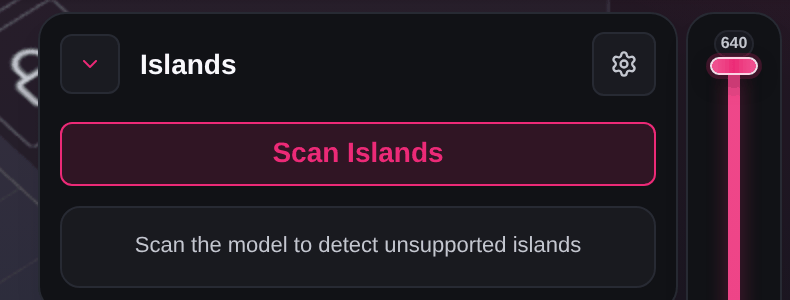

# Troubleshooting: Supports, updates and backups

Messages you may see while placing supports by hand, running auto supports and auto bracing, scanning for islands, updating DragonFruit, and using local backups. Where a fix says to report the problem, [Reporting a problem](common-issues.md#reporting-a-problem) lists what to include and where to find the log file. Find the message you're seeing; the fix comes first, and **More detail** has the rest.

## Placing supports by hand

!!! note "Turning the tooltips off"
    **Settings** > **General** > **Show support tooltips** hides the "Cannot Place Support" and "Stability Warning" tooltips. It does not change where supports can be placed.

### "Cannot Place Support"

<!-- source: src/supports/PlacementLogic/SupportLimitations.tsx -->

DragonFruit won't put a support at that spot; the second line of the tooltip says why. Move the cursor to a nearby spot that faces down or has a clear path to the build plate, or hold **Q** and click to place it anyway.

More detail

The tooltip is red and sits next to the cursor while you hover the model in **Support** mode. The preview support turns red too, and a click doesn't place it.

| Message contains | What it means |
| --- | --- |
| "Surface angle is upward facing. Supports cannot be placed here." | The surface faces up, or is too close to a vertical wall. A support tip must touch a surface that faces down. |
| "Support base must be below the tip (knot cannot be above the tip)." | The point where the support would join its parent is higher than the contact point. |
| "Contact point is lower than the stump root — the shaft would extend below the root joint." | The reason as stated. |
| "Support would collide with the model geometry." | No path to the build plate was found that doesn't pass through the model. |
| "Too close to an existing support." | Move away from the support that's already there, or delete it first. |
| "Support placement is outside the build volume." | Part of the contact would sit below the build plate. |

For an upward-facing surface, rotate the model so that area faces down. Setting **Cone Angle** to **Locked** or **Adaptive** in the Support Studio also accepts surfaces a few degrees steeper than **Normal** does.

**Q** is the default key; you can change it in **Settings** > **Hotkeys**. Supports forced in this way can print badly, so check them in the preview.

### "Stability Warning"

<!-- source: src/supports/PlacementLogic/SupportLimitations.tsx -->

The support can still be placed; this yellow tooltip just says it may not do much good. If it's meant to hold up an overhang, move the tip to a surface that faces down. If you only want sideways bracing, ignore it.

More detail

It appears next to the cursor while you place or drag a support. The line under the title is one of these:

- "Horizontal angles are not good for holding up overhangs. They are only good for lateral stability." The contact point is on a near-vertical wall. A support there steadies the model sideways but does little to hold up an overhang.
- "Support angle is too flat (must be >10° from horizontal)." The shaft would lie too flat. While you drag a knot or joint, DragonFruit holds it back to a safe angle and shows this warning; move it back toward a steeper angle until the warning clears.

## Auto supports, bracing and presets

!!! note "Not errors"
    "No eligible supports found for Auto Bracing." means there aren't enough supports near each other to brace. "No braces to remove on this model." means **Clear All** had nothing to remove. Both are shown in yellow and nothing is wrong. If bracing fails with an error instead, see [Messages with no known user fix](#messages-with-no-known-user-fix).

### "Save failed"

<!-- source: src/supports/Settings/SupportSidebar.tsx -->

Your support and raft settings weren't stored, so they may be gone after a restart. Click the save button again.

More detail

The message shows for two seconds as the tooltip of the save button in the **Support Studio** header, after you click it. DragonFruit couldn't write the settings to the app's own storage. The settings you see still apply to this session.

If it keeps failing, restart DragonFruit and change the settings again. If it fails after a restart, [report it](common-issues.md#reporting-a-problem).

### "Invalid auto-support preset file: …"

<!-- source: src/components/controls/autoSupport/AutoSupportPresets.tsx -->

The file you chose isn't an auto-support preset this version can read. Pick a file made with **Export** in the same dialog; if someone sent it to you, ask them to export it again and send the file without changes.

More detail

The message appears under the preset buttons in **Auto Supports (Beta) Settings**, after you click **Import** and choose a file. The end of the message says why:

| Message contains | What it means |
| --- | --- |
| "not valid JSON.", "expected a JSON object." | The file isn't a preset file, or it's damaged |
| "unsupported kind." | The file is JSON, but not an auto-support preset. Files exported by DragonFruit end in `.dragonfruit-auto-support.json`. |
| "unsupported format version …" | The file was made by a different version of DragonFruit that uses another preset format. Update DragonFruit (see [Updates](#updates)), or ask for the preset from the same version you use. |
| "missing preset.", "missing preset name.", "settings must be an object." | Part of the preset is missing |

### "Built-in presets cannot be deleted"

<!-- source: src/components/controls/autoSupport/AutoSupportPresets.tsx -->

Built-in presets ship with DragonFruit and are locked. Select one and click **Duplicate**, then rename, change and save the copy.

More detail

This is the tooltip on the greyed-out **Delete** button in **Auto Supports (Beta) Settings** when a built-in preset is selected. **Rename** shows "A built-in's name is translated and cannot be renamed", and **Save** shows "A built-in preset cannot be saved over — Duplicate it to make it yours". You can delete your copy at any time.

### "Scan the model to detect unsupported islands"

<!-- source: src/components/controls/IslandsPanel.tsx -->

Click **Scan Islands** again and wait for **Scanning…** to finish. If a model with clear overhangs never shows islands, right-click it, choose **Repair** > **Auto-Repair**, and scan again.

More detail

This shows in the **Islands** panel before a scan, and stays after a scan that found nothing. Either the scan found no islands at all (including supported ones and ones that touch the plate), or it stopped without a message because the model couldn't be prepared for scanning.

If repairing doesn't help, [report it](common-issues.md#reporting-a-problem) and attach the model.

## Updates

!!! note "Save your work first"
    DragonFruit tries to autosave before it updates, and the confirm dialog warns "Unsaved changes may be lost." Save your scene before you click **Update & Restart**.

### "Update failed"

<!-- source: src/features/updater/UpdateCheckerSection.tsx -->

Read the line under the title. If it starts with "Update failed:" or "No cached update", click **Retry** and then **Install** again; for any other reason the update has probably installed, so restart DragonFruit and check the version in **Settings** > **About**.

More detail

The message appears in **Settings** > **Updates**, after you click **Install** and confirm **Update & Restart**. DragonFruit downloads the update, checks its signature, then starts the installer; the reason line says which step failed.

| Message contains | What it means |
| --- | --- |
| "Update failed: …" | The download, the signature check or the installer failed. The text after the colon comes from the updater. |
| "No cached update. Call check_updates first." | The update found earlier is no longer ready, for example because an earlier attempt already used it |
| Any other reason | The update installed, but DragonFruit couldn't restart itself. The line shows the restart error. |

**Retry** checks for updates again. If retrying fails, check your internet connection; firewalls or proxies that block GitHub can stop the download. If it keeps failing, download the latest version from https://github.com/Open-Resin-Alliance/DragonFruit/releases and install it over the current one.

When you [report it](common-issues.md#reporting-a-problem), include the log file. For "Update failed: …" and "No cached update" the updater also writes the reason there. A restart error isn't written to the log file, so copy the reason line into your report.

### "Up to date" when a newer version exists

<!-- source: src/features/updater/UpdateCheckerSection.tsx -->

Either the check couldn't reach the update server or you're on the other release channel. Check your internet connection and click **Check Again**, then check the channel under the gear button.

More detail

**Settings** > **Updates** shows "Up to date" and "You’re on the latest version", but a newer release is listed on GitHub. A failed check shows "Up to date" instead of an error.

The gear button (**Release channel settings**) is at the top right of the tab. **Stable Builds** don't offer **Development Previews**, and the other way round.

If the check still finds nothing, download the release from GitHub and install it by hand.

### "Managed by Flatpak"

<!-- source: src/features/updater/UpdateCheckerSection.tsx -->

On Linux, DragonFruit ships as a Flatpak and is updated outside the app. Use your software center, or run the command shown in the tab: flatpak update org.openresinalliance.dragonfruit

More detail

This replaces the update checker in **Settings** > **Updates** on Linux. DragonFruit doesn't check for updates or show update notices there.

If you installed from a downloaded Flatpak bundle, click **Releases** and install the newer bundle.

## Local backups

These messages appear in **Settings** > **Backups**, in the bar at the bottom of the tab. Backups hold your app settings and printer and material profiles, saved as files in the **Selected directory**. Local backups work in the desktop app only.

!!! note "Automatic backups need the tab open"
    **Enable automatic backups** only makes backups while **Settings** > **Backups** is open. When you close the tab or Settings, no more automatic backups run. Click **Backup Now** before changes you may want to undo.

!!! note "The message does not show the exact cause"
    These messages don't include the reason the system gave for the failure. Check that the folder exists, that your user can write to it, and that the drive has free space.

### "Local backup sync failed."

<!-- source: src/components/settings/LocalBackupsSettingsTab.tsx -->

The backup couldn't be written. Check the folder under **Selected directory** exists and you can create files in it, or click **Use Default Path** and then **Backup Now** again.

More detail

This appears after you click **Backup Now**, or when an automatic backup runs (only while **Settings** > **Backups** is open). DragonFruit couldn't create the backup folder or write the backup files in it. Common causes are a folder you're not allowed to write to, a removed or disconnected drive, or a full disk.

**Use Default Path** goes back to the folder DragonFruit creates for you. Or click **Choose Folder** and pick a folder in your user folder.

### "Failed to choose local backup directory."

<!-- source: src/components/settings/LocalBackupsSettingsTab.tsx -->

If you just closed the folder picker without choosing, ignore this; your previous folder is still selected. Otherwise click **Choose Folder** again and pick a folder you can read and write.

More detail

It appears after you click **Choose Folder**. Cancelling the picker shows the same message, and nothing has changed. The other cause is that the picker opened, but DragonFruit couldn't read the backups in the folder you chose.

### "Failed to initialize local backups."

<!-- source: src/components/settings/LocalBackupsSettingsTab.tsx -->

DragonFruit couldn't set up its backup folder. Click **Use Default Path** if it's shown, or **Choose Folder** to pick another folder, and check the folder's drive is connected.

More detail

This shows when you open **Settings** > **Backups**. DragonFruit couldn't create its default backup folder, or couldn't read the latest backup in the selected folder.

If the message comes back every time, restart DragonFruit. If it still appears, [report it](common-issues.md#reporting-a-problem).

### "Failed to load local backup history."

<!-- source: src/components/settings/LocalBackupsSettingsTab.tsx -->

The list of past backups couldn't be read, usually because of folder permissions. Check you can open the selected folder and the history folder inside it, then click **Refresh**.

More detail

It can appear when the tab loads the list under **Manage Backups**, or after **Refresh**, **Refresh History** or **Backup Now**. DragonFruit couldn't list the backup history folder inside the selected folder. If it still fails, choose another folder with **Choose Folder**.

### "Failed to load backup snapshot."

<!-- source: src/components/settings/LocalBackupsSettingsTab.tsx -->

That snapshot couldn't be read. Click **Refresh** in case it was moved or deleted outside DragonFruit, or try an older snapshot.

More detail

This appears after you click **View snapshot** on an item under **Manage Backups**, and the snapshot window closes. The file couldn't be read, or it was changed or damaged after it was saved. "Backup snapshot is malformed." means the same thing, but the file was read and isn't a valid backup.

Delete a damaged snapshot with **Delete snapshot**.

### "Failed to restore backup snapshot."

<!-- source: src/components/settings/LocalBackupsSettingsTab.tsx -->

Nothing was restored and your current settings weren't changed. Check the selected folder can be written to, then close the snapshot window, click **Refresh**, reopen the snapshot and let it load fully before you click **Restore to App**.

More detail

It appears after you click **Restore to App** in the snapshot window and confirm **Yes, restore**. DragonFruit couldn't read the snapshot file, or couldn't write it back as the latest backup in the folder.

!!! note "A restore replaces your settings"
    A restore that works overwrites your current app settings and profiles with the snapshot and reloads the app. It cannot be undone. Click **Backup Now** first if you may want your current settings back.

### "Failed to delete backup snapshot."

<!-- source: src/components/settings/LocalBackupsSettingsTab.tsx -->

Another program probably has the file open, or folder permissions block it. Close any program that may have the backup folder open and try again, or delete the file by hand from the history folder inside the backup folder.

More detail

This appears after you confirm **Delete** in the **Delete Backup Snapshot** dialog: the snapshot file couldn't be removed.

### "Failed to open folder in file manager."

<!-- source: src/components/settings/LocalBackupsSettingsTab.tsx -->

DragonFruit couldn't start your file manager. Copy the path under **Selected directory** and open it in your file manager by hand.

More detail

It appears after you click **Open Folder**. The file manager is Explorer on Windows, Finder on macOS, or the default file manager on Linux. On Linux, check that a default file manager is set for your desktop.

!!! note "Open Folder on Linux"
    On Linux, **Open Folder** opens the folder that contains your backup folder, not the backup folder itself. Open the backup folder from there. If the file manager starts but then fails, DragonFruit does not notice and shows no message. Open the path from **Selected directory** by hand.

## Messages with no known user fix

These come from unexpected errors, and the code doesn't point to a common cause. Try the step again, then save the scene, restart DragonFruit and try once more; if the message comes back, [report it](common-issues.md#reporting-a-problem).

<!-- source: src/supports/Settings/SupportSidebar.tsx -->

| Message | Where you see it | Also include in your report |
| --- | --- | --- |
| "Auto Brace failed. Check console for details.", "Clear All failed. Check console for details." | After **Apply** or **Clear All** on the **Bracing** tab of the Support Studio, or the **G** hotkey while that tab is open | Which model and supports you had, and the scene file if you can. The details go to the developer console only, not the log file. |
